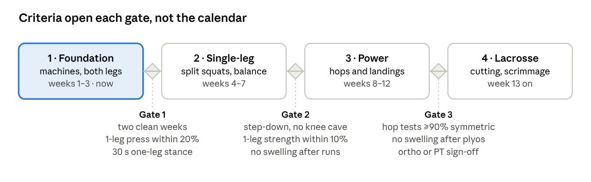
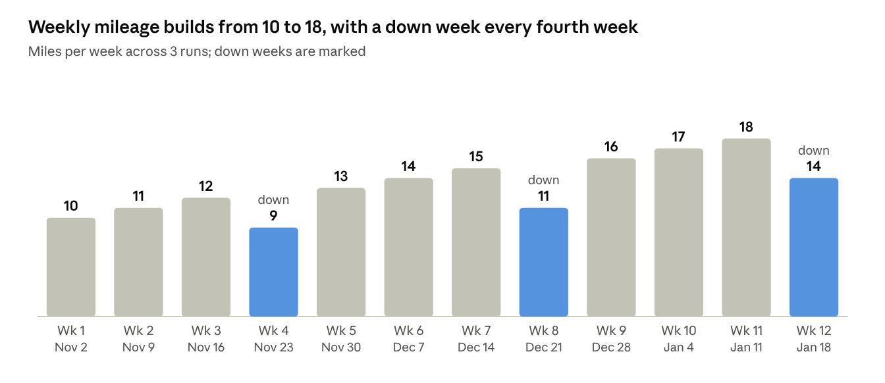

<!--
Exported from "Knee Rebuild: Full-Body Program" (Oct 30, 2026) with pandoc on Oct 31, 2026.
Edits to the export: image paths point at docs/media/, and a transcription table was added
under each of the two chart images so the numbers are readable without the image.
Training content is otherwise verbatim. This file wins on training content; PROMPT.md wins
on app behavior.
-->

# Knee Rebuild: Full-Body Program

Oct 30, 2026 · @Shawn

## Where you are

You're 13 weeks out from a multi-ligament knee sprain, running continuous 5Ks three times a week, and two weeks past your last logged lift. The program starts from that, not from zero.

What Strava shows since the knee test on Sep 28:

- Running: since Oct 12 you've covered 3–4 miles three times a week on hilly routes at 8:16–9:26 per mile, roughly 7–10 miles a week. The Oct 23 "Sad PR" 5K was a near-max effort (relative effort 92; your other runs sat between 17 and 70).

- Lifting: 40–55 minute gym sessions about three times a week through Oct 17, usually with elliptical or stair climber bolted on. Nothing logged since.

- Cadence sits at 84–86 on Strava, which counts one foot, so about 170 steps a minute. That's fine; nothing here asks you to shorten your stride.

What this assumes:

- Lifting happens at Planet Fitness: Smith machines, dumbbells to 75 lb, cable stations, the selectorized machine line, and the step platforms from the 30-minute circuit. No barbells, racks, boxes, or sleds.

- Three full-body lifts and three runs a week, six training days, close to your early-October pattern.

- The upper body trains at full effort. The knee is the only governor.

- No surgery and no written PT protocol. If your ortho or PT has given you restrictions, those override anything here.

- Phase dates assume no setbacks. The gates in the next section set the real pace.

## Operating rules: criteria, not calendar

Every session is a load test and the knee's 24-hour response is the inspection report: progress when the report is clean twice running, hold when it's noisy, back off when it's bad. The phase dates are estimates; the gates decide.

Engineers don't open a bridge on a date; they load-test it and open it when it passes. The same logic applies here because ligament remodels for 6–12 months after a sprain and is the last tissue to catch up. At 13 weeks the pain is mostly gone while the collagen is still realigning, so "feels fine" is a lagging indicator.

four phases, three gates · estimated dates from Nov 2, 2026

*Transcribed from the diagram above during the Markdown export (the image is the source):* **Criteria open each gate, not the calendar.**

| Phase          | Focus                 | Weeks            |
|----------------|-----------------------|------------------|
| 1 · Foundation | machines, both legs   | weeks 1–3 · now  |
| 2 · Single-leg | split squats, balance | weeks 4–7        |
| 3 · Power      | hops and landings     | weeks 8–12       |
| 4 · Lacrosse   | cutting, scrimmage    | week 13 on       |

Gate 1 (after Phase 1): two clean weeks; 1-leg press within 20%; 30 s one-leg stance. Gate 2 (after Phase 2): step-down, no knee cave; 1-leg strength within 10%; no swelling after runs. Gate 3 (after Phase 3): hop tests ≥90% symmetric; no swelling after plyos; ortho or PT sign-off.

Each diamond is a gate: the criteria under it have to be met, and met twice, before the next band starts, whatever the dates say.

| Signal                  | Clean                                           | Hold                                                        | Back off                                                   |
|-------------------------|-------------------------------------------------|-------------------------------------------------------------|------------------------------------------------------------|
| Pain during a set, 0–10 | 3 or under, not climbing set to set             | 4–5, or climbing                                            | Over 5, or sharp pain on the joint line: stop the exercise |
| Next morning            | Back to baseline; stiffness gone within 30 min  | Stiffer or sorer than the day before, clears within the day | Visible swelling, warmth, or pain up 2+ points             |
| Across the week         | Each session as good as or better than the last | One off session                                             | Two off sessions in a row                                  |

What each reading triggers:

- Clean twice in a row: progress that exercise one notch — load, range, step height, or the single-leg version.

- Hold: repeat the last session's loads exactly.

- Back off: cut that exercise's load 20–30% or step back to its earlier version. If the whole knee is complaining, the next run becomes an elliptical session and the next lift's lower-body work runs at Phase 1 loads.

Loading rules:

- Double progression. Pick the rep range (say 8–12). When every set hits the top of the range at RPE 8 or under, add the smallest increment (5 lb per dumbbell, one plate on a stack, 10 lb on the Smith) and start again at the bottom. RPE 8 means two reps left in the tank.

- Lower body starts at RPE 6 in Phase 1 and reaches RPE 8 on the main lifts by Phase 3. Upper body runs RPE 7–9 from day one.

- The injured leg goes first on every single-leg exercise and sets the rep count for the other side. Symmetry is the goal, so the healthy leg doesn't get to run ahead.

- Any exercise can be swapped for one on the same row of the substitutions table at the end; the slot's job stays the same.

- Weeks 4, 8 and 12 are deloads: lifting sets down by a third at the same loads, with the mileage down weeks landing on the same weeks. Weeks 4 and 8 are also Thanksgiving and Christmas weeks, so the easy weeks fall where life gets busy anyway.

## Weekly template

Six training days alternating lifts and runs, Sunday off. Each lift is a full-body session of about 60 minutes including the warm-up.

| Day | Session   | Notes                                                                        |
|-----|-----------|------------------------------------------------------------------------------|
| Mon | Run: MBR  | Easy and conversational. Hills are fine; surging isn't                       |
| Tue | Lift A    |                                                                              |
| Wed | Run: easy | Flattest route you have. Elliptical instead if the knee reads Hold           |
| Thu | Lift B    |                                                                              |
| Fri | Run: long | The week's longest run. One faster effort every other Friday from Phase 2 on |
| Sat | Lift C    |                                                                              |
| Sun | Off       | Kona walk and mobility only                                                  |

Running the day after a lift is deliberate: easy runs on tired legs are low risk, and the layout keeps Sunday completely off. If the knee flares on this schedule, stack instead: lift and run on the same day (lift first, easy run or elliptical after), which buys a second full rest day. Sprint coaches call that high/low; stack the stress, then rest hard.

| Program slot      | What you'll use at Planet Fitness                                                                                          |
|-------------------|----------------------------------------------------------------------------------------------------------------------------|
| Squat pattern     | Smith machine (box squat to a bench), leg press, dumbbells for goblet and split squats                                     |
| Hinge pattern     | Dumbbell RDLs, Smith machine RDL, 45° back extension bench, Smith hip thrust                                               |
| Single-leg        | Step platforms from the 30-minute circuit (stackable risers), a flat bench for Bulgarians, the leg press one leg at a time |
| Hamstrings        | Seated or lying leg curl; later, Nordic negatives with your heels under the lat pulldown thigh pad                         |
| Hips              | Hip abductor and adductor machines, a cable station with an ankle strap, a mini band                                       |
| Calves            | Seated calf machine or calf raises on the leg press; a step for single-leg work                                            |
| Balance and plyos | Mats, a bosu or balance pad if your club has one, a circuit step for low hops, floor tape for hop tests                    |
| Upper body        | Dumbbells to 75 lb, cable crossover, lat pulldown, seated row, chest and shoulder press machines, assisted pull-up/dip     |
| Cardio            | Upright bike for warm-ups, treadmill, elliptical, rower, stair climber                                                     |

Bring two things, about \$20 total: a cable ankle strap and a mini loop band. Most clubs have neither, and both fit in a jacket pocket. Clubs vary in what's on the floor; check yours on the first visit and lean on the substitutions at the end.

## Phase 1: Foundation (weeks 1–3, Nov 2–22)

Three machine-dominant full-body sessions that re-teach the knee to take load through a pain-free range while the upper body trains hard. Lower-body work starts at RPE 6 and earns its way to 7; feeling under-challenged for two weeks is the design, not a bug.

If you're already leg-pressing and squatting pain-free, treat Phase 1 as a two-week calibration and move on once Gate 1 is clean. Warm-up first (see the warm-up section), then:

**Session A**

| \#  | Exercise                                      | Sets × reps                | Cues                                                                                                           |
|-----|-----------------------------------------------|----------------------------|----------------------------------------------------------------------------------------------------------------|
| 1   | Leg press, both legs                          | 3 × 10–12, RPE 6→7         | Feet high and shoulder-width; lower for 3 s; stop at 90° or wherever pain stays at 3 or under; no hard lockout |
| 2   | Seated leg curl                               | 3 × 12–15, RPE 7           | Hamstrings are the knee's dynamic brakes. Full range, 2 s on the way back                                      |
| 3   | Dumbbell bench press                          | 3 × 8–10, RPE 8            |                                                                                                                |
| 4   | Lat pulldown                                  | 3 × 10–12, RPE 8           |                                                                                                                |
| 5   | Hip abductor machine                          | 2 × 15–20, RPE 7           | Pair with 6                                                                                                    |
| 6   | Standing calf raise on the leg press or Smith | 3 × 12–15                  | 2 s pause at the top                                                                                           |
| 7   | Single-leg balance, injured side              | 3 × 30 s                   | Between calf sets. Eyes closed once 30 s with eyes open is easy                                                |
| 8   | Dead bug                                      | 3 × 8 each side            | Slow, low back pressed into the mat                                                                            |
| 9   | Optional finisher                             | 10–15 min elliptical, easy |                                                                                                                |

**Session B**

| \#  | Exercise                       | Sets × reps        | Cues                                                                                                                                                                                        |
|-----|--------------------------------|--------------------|---------------------------------------------------------------------------------------------------------------------------------------------------------------------------------------------|
| 1   | Smith machine box squat        | 3 × 8–10, RPE 6→7  | Bench behind you so the hips stop just above knee height. Feet 6–12 in. ahead of the bar, safeties set; sit back, touch, stand. Goblet squat to the bench if the Smith is taken or it hurts |
| 2   | Smith machine hip thrust       | 3 × 12, RPE 7      | Shoulder blades on a bench, bar across the hips over a folded mat, 2 s squeeze at the top. Dumbbell glute bridge on the floor as the fallback                                               |
| 3   | Seated cable row               | 3 × 10–12, RPE 8   |                                                                                                                                                                                             |
| 4   | Seated dumbbell shoulder press | 3 × 8–10, RPE 8    |                                                                                                                                                                                             |
| 5   | Hip adductor machine           | 2 × 15, RPE 7      | The adductors brace the inside of the knee                                                                                                                                                  |
| 6   | Seated calf raise              | 3 × 15             |                                                                                                                                                                                             |
| 7   | Side plank                     | 3 × 30 s each side | Pair with 8                                                                                                                                                                                 |
| 8   | Pallof press, standing         | 2 × 10 each side   | Cable at chest height; press out and hold 2 s                                                                                                                                               |

**Session C**

| \#  | Exercise                         | Sets × reps            | Cues                                                                                                                             |
|-----|----------------------------------|------------------------|----------------------------------------------------------------------------------------------------------------------------------|
| 1   | Step-up to a 6–8 in. step        | 3 × 10 each leg, RPE 6 | Injured leg first; whole foot on the step; lower for 3 s; knee tracks over the second toe. Bodyweight in week 1, dumbbells after |
| 2   | Dumbbell Romanian deadlift       | 3 × 10, RPE 7          | Hinge with soft, fixed knees; dumbbells slide down the thighs. Hamstrings and glutes without loading knee flexion                |
| 3   | Assisted pull-up                 | 3 × 6–10, RPE 8        | Lat pulldown if it's taken                                                                                                       |
| 4   | Incline dumbbell press           | 3 × 8–10, RPE 8        |                                                                                                                                  |
| 5   | Leg extension, light             | 2 × 15, RPE 6          | From 90° to about 45°, stopping short of straight. Any kneecap or joint-line pain: wall sit 2 × 30–45 s instead                  |
| 6   | 45° back extension               | 2 × 12                 | Hands across the chest; hold a plate once 12 is easy                                                                             |
| 7   | Farmer's carry                   | 3 × 40 yd              | The heaviest dumbbells you can carry with tall posture                                                                           |
| 8   | Cable hip abduction, ankle strap | 2 × 12 each side       | Stand on the injured leg while the other leg works; the standing leg is the one training                                         |

Progression inside the phase:

- Add 5–10 lb when the top of a rep range is clean twice.

- Step height goes up 2 in. once 3 × 10 with 20 lb dumbbells is clean.

- Balance progresses from eyes open to eyes closed, then onto a folded mat.

Gate 1, to leave Phase 1: two consecutive clean weeks; 10 single-leg leg presses on the injured side within 20% of the other side's load; 30 s of single-leg stance with eyes closed; a 4-mile run with no next-morning reaction.

## Phase 2: Single-leg strength and balance (weeks 4–7, Nov 23–Dec 20)

Same A/B/C skeleton and the same upper-body progression; the lower-body slots trade two-legged machine work for the single-leg patterns running and lacrosse are built on. Loads move from RPE 6–7 to 7–8 across the four weeks.

Week 4 is a deload, which makes it the right week to learn the new movements: light loads, perfect reps, and Thanksgiving in the middle of it.

| Slot | Phase 2 exercise                                          | Sets × reps                             | Cues                                                                                             |
|------|-----------------------------------------------------------|-----------------------------------------|--------------------------------------------------------------------------------------------------|
| A1   | Single-leg leg press (replaces two-leg press)             | 3 × 10 each leg, RPE 7                  | Injured leg first and it sets the reps; same high foot position                                  |
| A2   | Single-leg seated leg curl                                | 3 × 10–12 each leg                      |                                                                                                  |
| A6   | Single-leg calf raise on a step                           | 3 × 12–15 each                          | Hand on the rail for balance only, not for help                                                  |
| A7   | Balance on a folded mat or bosu                           | 3 × 30 s                                | Add slow head turns, then eyes closed                                                            |
| B1   | Bulgarian split squat (replaces Smith box squat)          | 3 × 8 each leg, RPE 7                   | Rear foot on a flat bench, dumbbells at the sides, front shin near vertical, lower for 3 s       |
| B2   | Single-leg hip thrust, shoulders on the bench             | 3 × 10 each leg                         | Go back to the heavier two-leg Smith version if the single-leg version bothers the knee          |
| B5   | Copenhagen plank, short lever (replaces adductor machine) | 3 × 15–20 s each side                   | Side plank with the top knee on a bench. Adductors do a lot of the work in cutting               |
| B6   | New: lateral step-down from a 6–8 in. step                | 3 × 8 each leg                          | Slow. Film it from the front; the knee stays over the foot and doesn't cave inward               |
| C1   | Step-up to 12–16 in. with dumbbells                       | 3 × 8 each leg                          | Height grows before load does                                                                    |
| C2   | Single-leg RDL (replaces two-leg RDL)                     | 3 × 8 each leg                          | Dumbbell in the opposite hand, hips square. Tap the free foot down and reset if you lose balance |
| C5   | Leg extension, 90° to 30°                                 | 2 × 12–15, RPE 7                        | Still stopping short of straight                                                                 |
| C6   | New: reverse lunge with dumbbells                         | 3 × 8 each leg                          | Stepping back is kinder to the knee than stepping forward; walking lunges wait for Phase 3       |
| C8   | Lateral band walk, then cable hip abduction               | 2 × 12 steps each way, 2 × 12 each side | Mini band above the knees, quarter squat, no waddle                                              |

Everything not listed (the pressing, pulling, carries and core) carries over from Phase 1 with double progression.

From week 6, add landing prep at the start of sessions A and C: snap-downs, 3 × 5. Stand tall, drop into an athletic stance and freeze for 2 s. No jump yet; this is the absorbing half, taught before the exploding half.

Gate 2, to leave Phase 2: 10 lateral step-downs each side with no inward knee drift on video; single-leg leg press and Bulgarian loads within 10% side to side; 20 single-leg calf raises each side; no swelling after any run or lift for two weeks.

## Phase 3: Power, deceleration and lacrosse prep (weeks 8–12, Dec 21–Jan 24)

Plyometrics enter at the front of sessions A and C, the main lower lifts move to heavier sets of 6–8, and strides return to one run a week. Order inside a session matters: hops while fresh, then strength, then anything that burns.

| Weeks          | At the start of A and C, after the warm-up                                                                                                                      | Volume                                                    |
|----------------|-----------------------------------------------------------------------------------------------------------------------------------------------------------------|-----------------------------------------------------------|
| 8–9            | Pogo hops on both feet with stiff ankles; step-off landings from a 6–8 in. step, stuck for 2 s; lateral line hops on both feet                                  | 3 × 15 s; 3 × 5; 3 × 10 s                                 |
| 10–11          | Single-leg pogos; jump onto the circuit step and step down (never jump down); skater bounds with a stuck landing; single-leg forward hop and stick at about 70% | 3 × 10 s each leg; 3 × 5; 3 × 4 each side; 3 × 3 each leg |
| 12 (down week) | Repeat hops, 3 in a row, both feet then single leg; continuous skater bounds; 45° change-of-direction at a jog on an open patch of floor                        | 2 × 3 each; 2 × 6; 2 × 6 cuts each way                    |

Landing rules: every landing is quiet and stuck, about 40 ground contacts a session is plenty at this stage, and a loud landing or a knee that caves inward ends the set.

| Session | What changes                                                                                                                                                                                                                                                                   |
|---------|--------------------------------------------------------------------------------------------------------------------------------------------------------------------------------------------------------------------------------------------------------------------------------|
| A       | Leg press 4 × 6–8 at RPE 8. Nordic hamstring negatives 3 × 3–5: kneel on a mat with your heels under the lat pulldown thigh pad set low, lower as slowly as you can, catch yourself with your hands, push back up. Single-leg leg press stays at 3 × 8 as the second quad move |
| B       | Bulgarian split squat 4 × 6 each leg at RPE 8. Smith hip thrust 4 × 8, heavy. New: lateral lunge with a dumbbell, 3 × 8 each side, for the side-to-side strength cutting runs on. Copenhagen plank goes long lever (ankle on the bench)                                        |
| C       | Reverse lunge becomes walking lunge with dumbbells, 3 × 8 each leg. Single-leg RDL 3 × 6–8 at RPE 8. Step-up to a high step with a knee drive at the top. Single-leg calf raise holding a dumbbell                                                                             |
| Upper   | Structure unchanged; keep running double progression. Add a fourth upper slot (face pulls or the rear-delt machine) if sessions finish under 55 minutes                                                                                                                        |

Running in Phase 3: from week 8, finish Wednesday's run with 4 × 15 s strides building to about 85% effort, full walk-back between. From week 10, if Gate 2 was clean, Friday's run carries a 2 × 5 min comfortably-hard segment with 3 min easy between.

Gate 3, to leave Phase 3: single hop, triple hop and crossover hop for distance, each leg, best of three, with the injured side at 90% or better of the other; single-leg leg press 8RM within 10%; no swelling the morning after a plyo session; you'd trust the knee at full speed without thinking about it; ortho or PT sign-off before anything with contact.

Phase 4 preview, week 13 on, a week or two per rung with the same clean-twice rule:

1.  Wall ball and shooting with jog footwork

2.  Planned cuts at 50%, then 75%, then 100%

3.  Reactive cuts, with a partner calling the direction

4.  Non-contact scrimmage

5.  Full contact, in a brace for the first weeks if your ortho wants one

When Gate 3 is clean, I'll write Phase 4 in this same format.

## Running and cardio

Three runs a week, weekly mileage from 10 to 18 by week 11 with a down week every fourth, and almost all of it easy. Your engine came through the layoff fine (the watch read a VO2 max estimate of 55 on Sep 28); the chassis is what's still being re-welded, so volume follows the knee, not your lungs.

typed from the plan above · 12 weeks from Nov 2, 2026

*Transcribed from the chart above during the Markdown export (the image is the source):* **Weekly mileage builds from 10 to 18, with a down week every fourth week.** Miles per week across 3 runs; down weeks are marked.

| Week | Starts | Miles | Down week |
|------|--------|-------|-----------|
| 1    | Nov 2  | 10    |           |
| 2    | Nov 9  | 11    |           |
| 3    | Nov 16 | 12    |           |
| 4    | Nov 23 | 9     | down      |
| 5    | Nov 30 | 13    |           |
| 6    | Dec 7  | 14    |           |
| 7    | Dec 14 | 15    |           |
| 8    | Dec 21 | 11    | down      |
| 9    | Dec 28 | 16    |           |
| 10   | Jan 4  | 17    |           |
| 11   | Jan 11 | 18    |           |
| 12   | Jan 18 | 14    | down      |

Weeks 4, 8 and 12 drop back to let the knee consolidate, then the build resumes from a higher floor.

- The long run is at most 40% of the week's miles and grows about half a mile a week; the other two runs split the rest.

- Monday's MBR stays social and easy, Wednesday is the flat easy run, Friday is the long one.

- 80/20: Phase 1 is all easy. One faster Friday every other week from Phase 2; strides and a short tempo arrive in Phase 3 as written there. The Oct 23 effort is the kind of run to ration, not ban.

- The weekly number is a ceiling, not a quota. Knee clean: take it. Knee on Hold: repeat last week's.

- Swap any run for 30–40 minutes of elliptical or rower at the same effort when the knee says Hold; it costs nothing aerobically and spares the joint. On the rower, strap in, drive with the legs only through the pain-free range, and keep the stroke rate around 22–24.

- Stair climber: 5 slow minutes as a warm-up at most in Phases 1–2. It's a lot of loaded knee bending for the payoff.

- Treadmill at 1% incline when footing or weather is bad; the belt is the one place you control the terrain.

## Warm-up, mobility and recovery

Every lift opens with 5 minutes on the upright bike and a 5-minute knee circuit; the circuit is non-negotiable in Phase 1 and shrinks to 3 minutes once the plyos arrive in Phase 3.

Bike setup: seat high enough that the knee is slightly bent at the bottom of the stroke, easy resistance, no standing. Then the knee circuit:

1.  Terminal knee extensions with the mini band (or the cable and ankle strap), 2 × 15. Band behind the knee, straighten against it; this wakes up the quad.

2.  Glute bridge, 2 × 10 with a 2 s hold at the top.

3.  Lateral band walks, 2 × 10 steps each way.

4.  Bodyweight split squat through a partial range, 2 × 8 each leg.

5.  Leg swings, front-to-back and side-to-side, 10 each, with a hand on the Smith upright.

6.  Knee-to-wall ankle rocks, 10 each side; your existing ankle work carries straight over.

Before a run: 3–5 minutes of walking, then the leg swings and 10 bodyweight squats to a comfortable depth.

Off days: keep the thoracic, hip and ankle routine you already run. Add a 2 × 60 s couch stretch for the hip flexors and a 2 × 45 s calf stretch each side. If the knee doesn't fully straighten yet, add a heel prop, 3 × 2 min with the heel on a rolled towel and the knee hanging; full extension matters more than full bend for running.

Recovery:

- Ice for 10–15 minutes only if there's swelling; otherwise skip it.

- Sleep is the recovery variable that moves everything else. Protein around 0.7–1 g per pound of bodyweight supports the tissue work.

- Deload weeks 4, 8 and 12: lifting sets down a third at the same loads, mileage down as charted in the running section.

- If you use the stacked layout, the run after a lift is easy only.

## Red flags

Any of these means the session is over and the next call is to the ortho or PT, not a Hold and another try on Thursday.

- Swelling that shows up within hours of a session and isn't gone in 48 hours

- The knee giving way, buckling, or a shifting sensation under load

- Locking or catching: a mechanical block to straightening or bending

- Sharp pain on the joint line, or pain that wakes you at night

- Range of motion worse than it was the week before

- Pain climbing session over session despite two back-offs

- Numbness or tingling below the knee

Not flags: mild stiffness for the first 10 minutes, ordinary quad and glute soreness 24–48 hours after a new movement, and a knee that complains at the top of the stairs the day after Bulgarians.

## Setup notes and substitutions

Planet Fitness has everything this program needs except a barbell, so the cues below cover the handful of places where a machine or a makeshift fix does the barbell's job.

- Smith machine: the bar path is fixed, so set your feet 6–12 in. ahead of the bar for squats to keep the shins near vertical, and directly under it for RDLs. Set the safety stops every time. The bar's own weight varies by machine (usually 15–25 lb); ignore it and track plates.

- Leg press: on the seated machine, set the seat so the knees start at about 90°. Feet high on the platform shifts the work toward glutes and hamstrings and reduces shear at the knee.

- Step platforms: the 30-minute circuit's aerobic steps stack in roughly 2 in. risers; borrow one when the circuit isn't running. A flat bench is 17–18 in., which is Phase 2 height at the earliest.

- Nordic negatives: lat pulldown thigh pad at its lowest notch, kneel facing away with heels tucked under it, a mat under the knees. The back extension bench's foot plates work too.

- Hop tests: two strips of tape on the floor, a tape measure, best of three per leg, a minute between legs. Test fresh, before lifting, on the same day of the week each time.

- Dumbbells cap at 75 lb (60 at some clubs). When RDLs or carries outgrow the rack: single-leg RDL, a 4 s lowering, or the Smith machine RDL; carries become suitcase carries with one dumbbell.

- Dropping anything trips the lunk alarm; the Smith RDL is the legal deadlift.

| Taken or missing                 | Use instead, in order                                                                    |
|----------------------------------|------------------------------------------------------------------------------------------|
| Leg press                        | Smith box squat, then goblet squat to a bench                                            |
| Seated leg curl                  | Lying leg curl, stability-ball leg curl, or Nordic negatives from Phase 3                |
| Smith machine                    | Goblet squat or Bulgarians with dumbbells; dumbbell hip thrust with shoulders on a bench |
| Hip abductor or adductor machine | Cable with ankle strap; mini-band lateral walks; Copenhagen plank                        |
| Step platforms                   | The lowest stair in the club, or split squats until a step frees up                      |
| Lat pulldown                     | Assisted pull-up, then single-arm cable pulldown                                         |
| Dumbbell bench                   | Chest press machine, then Smith bench press                                              |
| Seated row                       | Chest-supported dumbbell row, then single-arm cable row                                  |
| Calf machine                     | Calf raises on the leg press, then single-leg on a step                                  |
| Bosu or balance pad              | Folded mat, then eyes closed on the floor                                                |
| Medicine ball (Phase 3)          | Cable rotational chop and lift                                                           |
